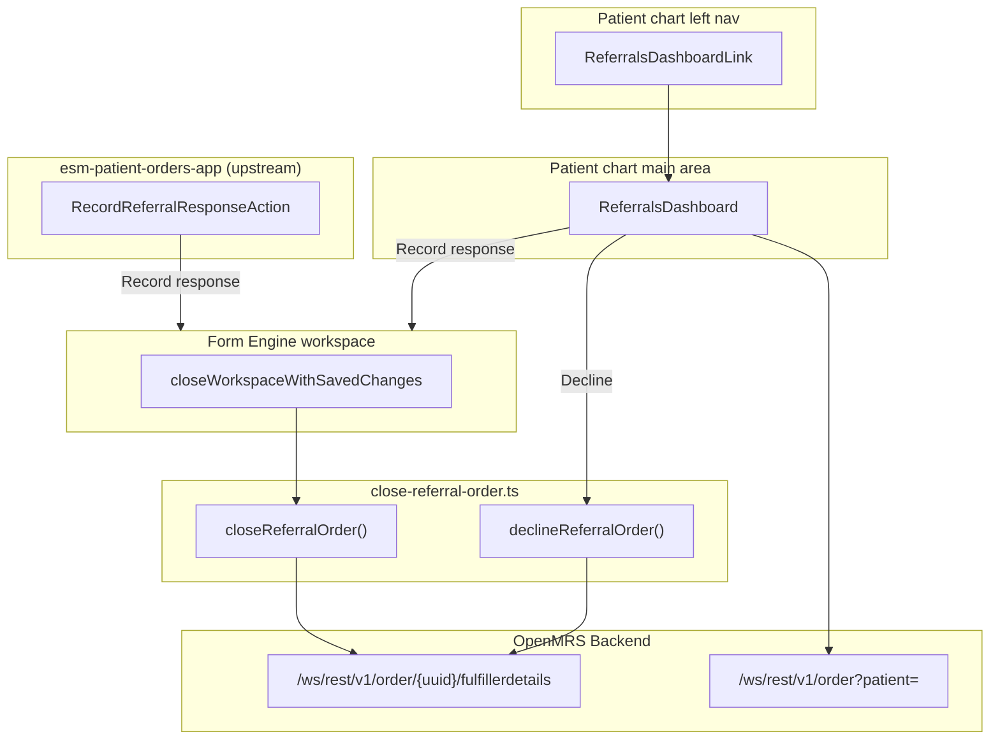
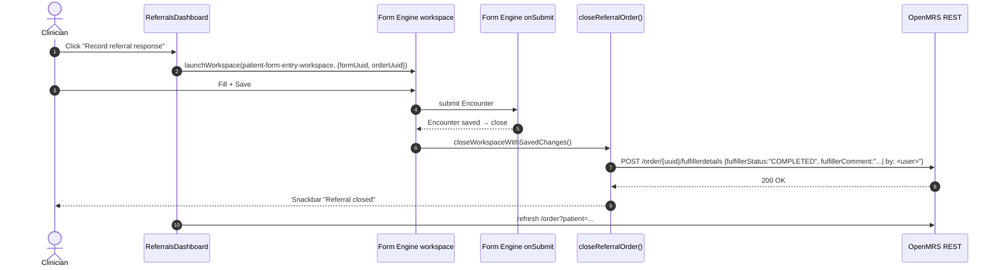
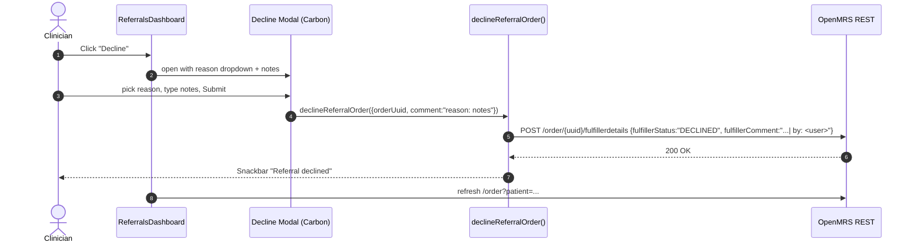

# Architecture

## 1. Purpose

`@openmrs/esm-referral-fulfillment-app` extends the OpenMRS O3 patient
chart with **referral fulfillment** UX:

1. A new left-nav chart tab — **Referrals** — listing every Referral
   order for the patient, with expandable detail rows.
2. A **Record referral response** action that opens the Referral
   Response form pre-bound to the clicked order, then closes the order
   on save.
3. A **Decline** action that records a structured reason (Carbon Modal
   + Dropdown + Notes) on the order without writing an encounter.
4. An overflow-menu action injected into the upstream
   `esm-patient-orders-app` Orders widget that mirrors (1) above.

The package is a **side-loaded ESM** — it ships as a single JS bundle
that is spliced into the upstream Reference Application image at
container start; no upstream code is forked.

## 2. Source Layout

```
packages/esm-referral-fulfillment-app/
├── src/
│   ├── index.ts                          ← lifecycle exports
│   ├── routes.json                       ← extension declarations
│   ├── config-schema.ts                  ← runtime config + types
│   ├── close-referral-order.ts           ← REST: COMPLETED & DECLINED
│   ├── dashboard-link.component.tsx      ← left-nav entry (Carbon side-nav)
│   ├── referrals-dashboard.component.tsx ← main chart-tab UI (DataTable + Modal)
│   ├── record-referral-response.component.tsx ← Orders-widget action button
│   └── declarations.d.ts
├── translations/                         ← i18n bundles (en.json baseline)
├── webpack.config.js                     ← inherits openmrs default
├── package.json
└── dist/                                 ← build output (gitignored)
```

## 3. Extensions Registered

Declared in [`src/routes.json`](../src/routes.json) and surfaced as
lifecycle exports in [`src/index.ts`](../src/index.ts).

| Extension Name              | Slot                                       | Component               | Role                                  |
| --------------------------- | ------------------------------------------ | ----------------------- | ------------------------------------- |
| `referrals-summary-dashboard` | `patient-chart-dashboard-slot`           | `referralsDashboardLink`| Left-nav link (chart tab entry)       |
| `referrals-details-widget`    | `patient-chart-referrals-dashboard-slot` | `referralsDashboard`    | Main dashboard widget                 |

> The action button injected into the upstream Orders widget is wired
> at runtime by patching the dynamic order-detail slot — see
> [`record-referral-response.component.tsx`](../src/record-referral-response.component.tsx)
> and the corresponding lifecycle export `recordReferralResponseAction`.

## 4. Component Boundaries



## 5. Sequence — Record Referral Response



## 6. Sequence — Decline Referral



## 7. Key Design Decisions

| Decision | Rationale |
| --- | --- |
| Encode fulfiller name in `fulfillerComment` via ` \| by: <name>` tag | OpenMRS Order REST does **not** bump `auditInfo.changedBy` on `/fulfillerdetails`; no first-class fulfiller-user field exists. The dashboard splits on the tag to render "Fulfilled by". |
| Side-loaded ESM (manifest + splice script) | Allows shipping a custom microfrontend without forking the upstream Docker image or rebuilding the importmap. Idempotent boot-time splice keeps upgrades cheap. |
| Carbon `Modal` + `Dropdown` for Decline | Consistent O3 visual language; dropdown enforces a small, clinically meaningful set of reasons; free-text notes via `TextArea` for the "Other" escape hatch. |
| `launchWorkspace` (workspaces v1) for form entry | `patient-form-entry-workspace` is published by `esm-patient-forms-app` and accepted by both v1 and v2 launchers. |
| Status colors driven by `fulfillerStatus` | Green = `COMPLETED`, Red = `DECLINED`, Gray = pending/`null`. Same enum used by the upstream Orders widget. |

## 8. Runtime Dependencies (peer)

- `@openmrs/esm-framework@next` — `openmrsFetch`, `useConfig`, `launchWorkspace`, `getSessionStore`, `showSnackbar`, `ConfigurableLink`, `getSyncLifecycle`.
- `@carbon/react@^1.71` — DataTable, Modal, Dropdown, TextArea, Button, Tag, InlineLoading, Tile, StructuredList.
- `react@^18`, `react-i18next@^16`, `rxjs@6.x`.
- Backend modules: `webservices.rest >= 2.2.0`, OpenMRS Order REST + FHIR ServiceRequest endpoints.

## 9. Out of Scope

- Cross-facility (SPICE-side) referral mirroring — handled by SPICE
  integration outside this module.
- Bulk decline / batch operations — single-order only.
- Notification dispatch — relies on existing OpenMRS event infrastructure.
