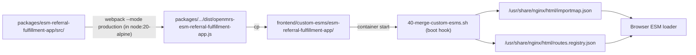

# Deployment Guide

This module ships as a **side-loaded ESM** — a single JS bundle that is
copied into the upstream OpenMRS frontend image's `custom-esms/`
directory and spliced into the importmap and routes registry at
container boot.

## 1. Pipeline Overview



## 2. Local Build & Deploy (One-shot)

Run from the **repo root**:

```bash
# 1. Build the bundle inside a node:20-alpine container (no host node needed)
docker run --rm \
  -v "$PWD/packages/esm-referral-fulfillment-app:/app" \
  -w /app node:20-alpine \
  sh -c 'npx webpack --mode production'

# 2. Fix ownership of the dist/ directory (root → host user)
docker run --rm \
  -v "$PWD/packages/esm-referral-fulfillment-app/dist:/d" \
  alpine chown -R "$(id -u):$(id -g)" /d

# 3. Replace the deployed bundle
rm -f frontend/custom-esms/esm-referral-fulfillment-app/*.js
cp packages/esm-referral-fulfillment-app/dist/*.js \
   frontend/custom-esms/esm-referral-fulfillment-app/

# 4. Recreate the frontend container so the boot-hook re-splices
docker compose up -d --no-build --force-recreate frontend
```

After step 4, hard-refresh the browser (`Ctrl-Shift-R`).

## 3. Manifest Registration

The boot hook reads
[`frontend/custom-esms/manifest.json`](../../../frontend/custom-esms/manifest.json):

```json
{
  "modules": [
    {
      "name": "@openmrs/esm-referral-fulfillment-app",
      "dir": "esm-referral-fulfillment-app",
      "entry": "openmrs-esm-referral-fulfillment-app.js"
    }
  ]
}
```

Each module additionally contributes a
`frontend/custom-esms/<dir>/routes.registry.json` that mirrors what
`@openmrs/esm-framework` would have read from the bundle's
`importTranslation`/`routes` exports. **Keep this file in sync with
`src/routes.json`** when adding extensions.

> If the manifest entry is missing, the bundle is still served by nginx
> but is **never loaded** — the importmap will not list it and no
> extensions will register.

## 4. Splice Script

[`frontend/40-merge-custom-esms.sh`](../../../frontend/40-merge-custom-esms.sh)
is mounted into the container at
`/docker-entrypoint.d/40-merge-custom-esms.sh` and invoked from the
container's startup wrapper:

```yaml
# docker-compose.override.yml (excerpt)
services:
  frontend:
    command: ["sh", "-c",
      "/docker-entrypoint.d/40-merge-custom-esms.sh; exec /usr/local/bin/startup.sh"]
    volumes:
      - ./frontend/custom-esms:/usr/share/nginx/html/custom-esms:ro
      - ./frontend/40-merge-custom-esms.sh:/docker-entrypoint.d/40-merge-custom-esms.sh:ro
```

The script is **idempotent** — already-spliced modules are skipped.
Failures are logged but never block nginx startup.

Verify the splice succeeded:

```bash
docker exec o3-frontend-1 sh -c \
  'grep -o "esm-referral-fulfillment-app" /usr/share/nginx/html/importmap.json | head -1'
# → esm-referral-fulfillment-app
```

## 5. EC2 / Production Notes

The pipeline above is identical on EC2 except:

1. The compose file used in production is the same `docker-compose.yml`
   + `docker-compose.override.yml` that lives at the repo root on the
   EC2 host (`/home/ubuntu/openmrs-distro-referenceapplication` or
   wherever the host clones the repo).
2. The `frontend/config-core_demo.json` mounted into the container
   contains EC2-specific overrides — **do not commit production UUIDs**.
3. SSL: when `docker-compose.ssl.yml` is layered, the same boot hook
   runs because the `frontend` service definition is unchanged.

A typical deploy on EC2:

```bash
ssh ubuntu@<host>
cd ~/openmrs-distro-referenceapplication
git pull --ff-only
# Build + splice + restart
bash scripts/deploy-referral-esm.sh   # if you wire one up; otherwise run the 4 commands from §2
```

## 6. Verification Checklist

After deploying, confirm:

- [ ] `docker logs o3-frontend-1 --tail 20` shows
  `[40-merge-custom-esms] spliced @openmrs/esm-referral-fulfillment-app into importmap`.
- [ ] `curl -s http://localhost:9096/openmrs/spa/importmap.json | jq '.imports | keys[] | select(test("referral"))'` returns the module.
- [ ] In the browser, the patient chart left-nav shows **Referrals** with the order icon.
- [ ] Opening the **Referrals** tab fetches `/ws/rest/v1/order?patient=…&v=full` (visible in DevTools Network).
- [ ] Clicking **Decline** opens a Carbon Modal with the structured reason dropdown.
- [ ] After clicking *Record referral response* and saving, the order's `fulfillerStatus` flips to `COMPLETED`
  (`curl http://localhost:8080/openmrs/ws/rest/v1/order/<uuid>?v=full` to confirm).

## 7. Rollback

The fastest rollback is to delete the bundle and restart:

```bash
rm -f frontend/custom-esms/esm-referral-fulfillment-app/*.js
docker compose up -d --no-build --force-recreate frontend
```

The boot hook will warn (`bundle missing for … skipping`) and the rest
of the frontend boots normally.

To keep a previous version handy:

```bash
cp frontend/custom-esms/esm-referral-fulfillment-app/openmrs-esm-referral-fulfillment-app.js \
   frontend/custom-esms/esm-referral-fulfillment-app/openmrs-esm-referral-fulfillment-app.js.prev
```

…then restore with `mv` if needed.
